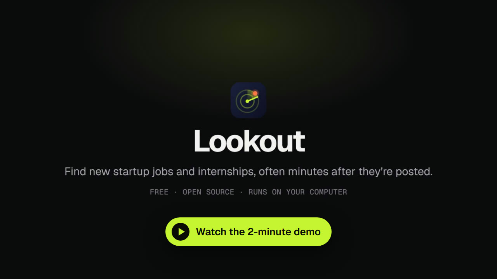
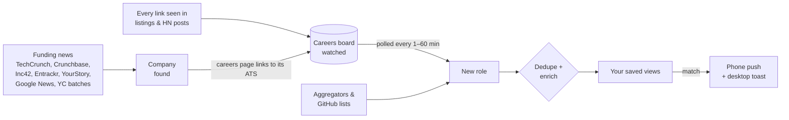

<p align="center"></p>

<h1 align="center">Lookout</h1>

<p align="center"><b>Find startup jobs and internships minutes after they're posted, before the job boards do.</b><br>
A local, near-real-time job scanner that watches freshly funded startups, deduplicates every source,<br>matches roles to the skills your résumé, LinkedIn and GitHub show, finds who to contact, and pushes matches to your phone.</p>

<p align="center"><a href="https://falconfuryx77.github.io/lookout/">Website</a> · <a href="https://github.com/FalconFuryX77/lookout/releases/latest">Download for Windows</a> · <a href="#browser-extension">Browser extension</a></p>

<p align="center"><a href="https://falconfuryx77.github.io/lookout/#demo"></a><br>
<sub>Two-minute demo, recorded in the real app with a made-up profile. <a href="docs/video/lookout-demo.mp4">Download the MP4</a></sub></p>

---

## Contents

- [What it does](#what-it-does)
- [Quick start](#quick-start)
- [Phone alerts](#phone-alerts)
- [How it finds jobs early](#how-it-finds-jobs-early)
- [It finds new sources on its own](#it-finds-new-sources-on-its-own)
- [Profiles and your résumé](#profiles-and-your-résumé)
- [Browsing](#browsing)
- [Filtering and saved views](#filtering-and-saved-views)
- [Who to contact](#who-to-contact)
- [Memory and storage](#memory-and-storage)
- [Deduplication and freshness](#deduplication-and-freshness)
- [Keyboard shortcuts](#keyboard-shortcuts)
- [Project structure](#project-structure)
- [Development](#development)
- [Troubleshooting](#troubleshooting)
- [Browser extension](#browser-extension)
- [Security](#security)
- [Privacy and limits](#privacy-and-limits)
- [License](#license)

---

## What it does

- **Watches companies directly.** Lookout polls company careers boards (Greenhouse, Lever, Ashby, Workable, SmartRecruiters, Recruitee, Oracle, Workday on `myworkdaysite.com`, YC Work at a Startup) every 1–60 minutes, faster for startups that just raised money.
- **Links funding to hiring.** Startups that just raised a seed or Series A round (from TechCrunch, Crunchbase, Inc42, Entrackr, YourStory, Google News and the latest YC batches) get their careers board found and watched automatically.
- **Covers aggregators too.** It also reads HN "Who is hiring", HN YC job posts, Simplify/vanshb03 GitHub lists, InternScan, Startup.jobs, Remote OK, We Work Remotely, Himalayas, Jobicy, Arbeitnow and Remotive.
- **Grows its own coverage, or uses yours.** It harvests new careers boards from every link it sees and finds new GitHub job lists on its own. You can turn that off, start from the starter list, and share your best boards with friends as a file.
- **Shows each role once, with the most direct link.** Roles are deduplicated across all sources, short links are followed, and Apply opens the employer's own listing whenever one is known.
- **Filters deeply.** Filter by field, 30+ role types, years of experience, visa sponsorship, work mode, location, pay, degree, internship term, funding stage, skills and more. Save any combination as a view.
- **Alerts you.** Phone alerts (ntfy) fire the moment a role matching a saved view appears, and each view can alert a different phone.
- **Matches you.** Import your résumé (read locally) and every role shows which of its skills you have; roles that ask for more experience than you have are hidden.
- **Checks other sites too.** A browser extension compares any job page with your profile and saves it to your pipeline.
- **Helps you reach out.** It finds published contacts (job post, company site, GitHub org, YC founders) and drafts a personalised outreach email.
- **Tracks your search.** A pipeline board holds saved, applied, contacted, interviewing and closed roles, with notes.
- **Stays on your machine.** Everything is stored locally in one file.

## Download

Get the latest Windows build from the [Releases page](https://github.com/FalconFuryX77/lookout/releases/latest): download `Lookout-windows.zip`, unzip it anywhere, and double-click `Lookout.exe`. The browser extension is inside, in the `extension` folder (also attached on its own as `lookout-extension.zip`). The landing page for the project is in [`docs/`](docs/index.html).

## Quick start

**Requirements:** Windows 10/11, [Node.js 20+](https://nodejs.org), and the Microsoft Edge WebView2 runtime (preinstalled on Windows 11). There are no npm packages to install.

### Option A: Windows app (recommended)

Double-click **`Lookout.exe`**, or the **Lookout** shortcut on your Desktop.

- It shows "Starting Lookout…" while the scanner loads your saved data (a few seconds), then opens the app.
- Closing the window keeps scanning in the background. Use the tray icon to reopen it, or **Exit Lookout** to stop.
- To put shortcuts on the Desktop and start Lookout automatically at sign-in, run once:

```powershell
.\setup-desktop.ps1
```

`.\setup-desktop.ps1 -Uninstall` removes the shortcuts.

### Option B: in your browser

```powershell
npm start
```

Then open <http://127.0.0.1:4173>.

Lookout only scans while it's running, so keep the computer awake if you want around-the-clock alerts.

## Phone alerts

1. Install **ntfy** (free on [Android](https://play.google.com/store/apps/details?id=io.heckel.ntfy) and [iOS](https://apps.apple.com/app/ntfy/id1625396347)). Subscribe to a long, hard-to-guess topic name.
2. In Lookout, open **Settings → Phone alerts**, enter the same topic, and press **Send test push**.
3. Click the **bell** next to any saved view and choose **My phone**.

**Sending a view to someone else.** Each view has its own alert destination. Click its bell and pick **A separate channel**, then enter either a topic name (`lookout-aisha-7fk2`, on your ntfy server) or a full address (`https://ntfy.sh/lookout-aisha-7fk2`). That person subscribes to the same name in their ntfy app. One view per friend means each of them only hears about roles that fit them. A role that matches several views is sent once per channel. Quiet hours only mute your own phone.

### LinkedIn

Lookout reads LinkedIn's **public** job search, the pages anyone sees logged out. It needs no account, cookie or password, and none is ever stored. Set your searches in **Settings → LinkedIn searches**, one per line as `keywords | location` (add `| remote` for remote-only). It checks every 4 minutes, asks only for roles posted in the last 3 hours, and reads the newest first, so a new role usually shows up within minutes of LinkedIn listing it. A slower sweep of the last day (about every half hour) fills in anything posted while your computer was off. Each new role's full description is fetched once.

Phone alerts for LinkedIn are only sent for roles posted in the last two hours; older ones still appear in the app. Each alert says how old the posting was when it was sent ("Posted 12 min ago").

This is deliberately gentle: a few searches, small pages, a pause between requests. LinkedIn rate-limits anonymous traffic, so if it starts refusing, Lookout backs off and tries again later. Automated access is against LinkedIn's terms of use; that is your call to make. Clear the box to turn it off.

Each alert has **Open listing** and **Email** buttons. If a scan finds more than 4 matches at once, they arrive as a single digest. Optional quiet hours are supported (for example `23:30-07:00`).

Alerts only fire for genuinely new roles. Startup imports and old listings never buzz your phone.

> Anyone who guesses a topic name on public ntfy.sh can read it. Use a long random name, or run your own ntfy server and add an access token in Settings.

## How it finds jobs early



The fastest signal is the company's own careers board: a role appears there before any aggregator copies it. So Lookout's main pipeline is **funding → careers board → alert**. A startup that raises a round is detected from the news, its board is found through its website, and that board is then checked every 2 minutes.

| Source | What | Checked every |
|---|---|---|
| Company careers boards | Greenhouse, Lever, Ashby, Workable, SmartRecruiters, Recruitee, YC company pages | 1 min (you added it), 2 min (just raised), 3 min (posting actively), 10–30 min (quiet), 60 min (YC pages) |
| Funding signals | TechCrunch (Venture, Startups), Crunchbase News, Entrackr, Inc42, YourStory, Google News (seed/Series A, India), yc-oss batch and hiring data | 5 min (YC data every 6 h) |
| Founder-posted roles | HN "Who is hiring" (new comments only), HN YC job posts | 1 min |
| Curated GitHub lists | SimplifyJobs internships and new grad, vanshb03, India Tech Internships, plus lists Lookout discovers | 2–5 min |
| India internships | InternScan India and US | 30 min (the source itself refreshes daily) |
| Job boards | Startup.jobs, Remote OK, We Work Remotely, Himalayas, Jobicy, Arbeitnow, Remotive | 2 min – 6 h, within each API's terms |

## It finds new sources on its own

- **Board harvesting.** Every link Lookout sees (list rows, HN posts, company sites) is checked for a careers board, and each new one is polled directly from then on. It typically watches about 1,800 boards within the first hour.
- **GitHub list discovery.** Every 6 hours it searches GitHub for new internship and new-grad lists. A list is added only if most of its rows are dated and it isn't more than 70% duplicates. Lists that stop contributing unique roles are retired automatically.
- **Adaptive polling.** Boards that just raised money or are actively posting get checked more often. Boards that keep failing back off, and dead ones are dropped.
- **Verified ownership only.** A board is attached to a company only when the company's own website links to it. Board names are never guessed from company names, because generic names like "elite" belong to unrelated companies.
- **Yield tracking.** The **Sources** page shows each source's unique contribution, boards grouped by polling speed, where new sources came from, and a running discovery log. Each source has an on/off switch there.
- **Platforms read directly:** Greenhouse, Lever, Ashby, Workable, SmartRecruiters, Recruitee, YC, Oracle Cloud recruiting, and Workday sites on `myworkdaysite.com`. Workday's main domain (`myworkdayjobs.com`) puts a browser security check in front of automated requests, so those companies are only seen when a list or job board carries their roles.

### Your own boards and lists (Settings → Sources)

- **Find new boards and lists on my own** turns all of the discovery above on or off. Off means Lookout keeps exactly the boards and lists you have, plus any you add.
- **How often to check:** *Auto* (busy boards every 1–3 minutes, quiet ones hourly), *Saver* (every 30 minutes to 2 hours) or *Slow* (every 6 to 24 hours). Slower means fewer requests and less battery, but later alerts.
- **Starter list:** about 2,000 careers boards and 8 community lists that were posting roles recently, offered as a one-click suggestion on a new install. It is rebuilt from public discoveries only with `node starter/make-starter.mjs`.
- **Share your list:** *Export* saves your boards and lists as a file, either everything or only the boards that produced roles matching your saved views or pipeline. The file holds no profile, pipeline or alert settings. *Import* adds a file someone sent you; *Remove all* clears everything first if you want to start from someone else's list alone.

The file is plain JSON, easy to read and edit by hand:

```json
{
  "lookout": "sources", "version": 1, "name": "ML internships, India",
  "boards": [ { "platform": "greenhouse", "board": "stripe", "company": "Stripe" } ],
  "lists":  [ { "repo": "SimplifyJobs/Summer2027-Internships", "name": "Simplify internships" } ]
}
```

`platform` is one of `greenhouse`, `lever`, `ashby`, `workable`, `smartrecruiters`, `recruitee`, `yc`, `oracle`, `workday`. A list that isn't built into Lookout also needs a `url` on `raw.githubusercontent.com`; lists are only ever read from GitHub.

## Profiles and your résumé

**Settings → Profile** is where Lookout learns who it is searching for.

- **Import your résumé** (PDF, Word .docx, or pasted text). It is read on your computer by the scanner itself; nothing is uploaded and no outside service is involved. Lookout pulls out your name, links, skills, education, experience and years of experience, saves them to the profile, and you can edit any of it afterwards. Scanned or image-only PDFs have no text to read; paste the text instead.
- **Skills** are split into technical ones (languages, frameworks, tools, engineering disciplines) and general ones ("Sales", "Operations", "Communication"). Technical skills are shown first and drive the match; general ones are kept but shown quieter, in the profile, on each role and in the Skills filter.
- **Matching.** Each role shows "You have 7 of 12" with the skills you have and the ones you are missing. Sorting by **Best match** ranks by that, and lowers roles that ask for more years than your profile has. **Filters → Skills → My skills** ticks every technical skill on your profile in one click.
- **Your links.** Separate boxes for GitHub, LinkedIn, your portfolio or personal site, and any other links (Kaggle, Hugging Face, LeetCode, Devpost, a blog). Importing a résumé fills them from the links in it.
- **Scan my links** reads those links on your computer and shows what your own work says about your skills:
  - **GitHub:** each repository's languages, the libraries in its dependency files (`package.json`, `requirements.txt`, `pyproject.toml`, `go.mod`, `Cargo.toml`, Gradle/Maven, `pubspec.yaml`, ...) and tell-tale files (Dockerfiles, CI workflows, Terraform, Kubernetes). No login needed; GitHub allows 60 requests an hour without one, about 25 repositories. A token in **Settings → Reading your links** lifts that.
  - **Your site:** up to 10 pages, one link deep, respecting `robots.txt`; skills listed under a "Skills" or "Tech stack" heading count more than passing mentions, and project repositories it links to are read too.
  - **Other links:** that page only. Pages that ask for a human check are left alone; open them in your browser and use the extension there.
  - **LinkedIn** is never read (it needs your login). On your LinkedIn profile choose **More → Save to PDF** and use **Import LinkedIn PDF**; it adds its skills and roles to the profile rather than replacing the résumé's.
- **Skill strength.** After a scan each skill is **strong** (your recent code uses it), **working** (listed, or shown once) or **familiar** (shows up rarely or long ago); hover a skill to see why. Skills your work shows but your profile doesn't list are offered as suggestions to add or dismiss. Nothing is added without you. Best match counts strong skills fully and listed-only ones a little less. Tick **Scan again once a week** to keep it current.
- **Projects found** lists your most substantial recent repositories with the stack each uses, ready to add to your projects.
- **Best match learns from you.** Once you have saved or applied to 5 roles and acted on 15, a small model in the app learns what you go for (field, stage, remote or not, visa, pay listed, funded company, skill fit) from what you save, apply to and hide, and nudges Best match toward roles like those. It never looks at posting dates, runs in the app window, and can be turned off in Settings.
- **Several profiles.** Use one per person sharing the computer, or one per kind of role you are going for. Each profile has its own résumé, skills, saved views, pipeline and blocked companies. Switch from the name at the bottom of the sidebar. Alerts keep going out for every profile's views, whichever one is open; give each person's views their own channel (the bell on a saved view) so pushes reach the right phone. Phone settings, sources and the job list itself are shared.

## Browsing

Rows on the left, the selected role on the right. Each row shows the title, company, location and up to three facts (pay, visa, experience, remote, funding).

**Settings → Appearance** has the theme (system, light, dark) and density (comfortable or compact).

## Filtering and saved views

Press **F** to open the filter sheet. Every count updates live, and active filters appear as removable chips above the list.

**Every option has three states:** click once to include it, again to exclude it (it turns red and struck through), and once more to clear it. Excluding drops roles that have the value; for degree, internship term and source a role is dropped only when every value it has is excluded, because it is still open to you otherwise.

| Filter | Options |
|---|---|
| Posted | last 15 min, 1 h, 6 h, 24 h, 3 d, 7 d, 30 d, any. Short windows only count roles with an exact posting time. |
| Field | Software & IT, Hardware & physical engineering, Product & design, Business, Science & research. Click once to include, twice to exclude. |
| Role | AI/ML, data science, data engineering, analytics, frontend, backend, full-stack, mobile, DevOps/cloud, security, QA, embedded, IT & support, quant, and more |
| Experience | pick any stages (internship, apprenticeship, entry / new grad, mid, senior, lead, part-time, contract); a role shows if it matches **any** of them. Plus a years slider, with an option to include roles that don't say. |
| Visa sponsorship | sponsors, no sponsorship, citizens/clearance only, not stated. One click for "I need sponsorship". |
| Work mode, location | remote, hybrid, on-site; by country/region |
| Minimum pay | normalised to USD per year from $, ₹ (LPA, lakh), €, £, CAD and others, including hourly and monthly rates |
| Degree, term | roles that accept a bachelor's, master's or PhD; internship season |
| Company | recently funded only; stage (YC, seed, Series A, B+); hide staffing agencies; permanently blocked companies |
| Skills, source, keywords | has any / has all skills; specific sources; confirmed by 2+ sources; **only roles mentioning** and **hide roles mentioning** (comma-separated words, searched in the whole posting); has a contact email |

**Search syntax:** `intern python | go -senior` (a space means AND, `|` means OR, `-` means NOT, and `"quotes"` match an exact phrase).

**Saved views** in the sidebar store any filter combination. A view shows its total, plus a green `+N` for roles posted in the last hour. Turn on its bell to get phone alerts.

**Best match** sorting ranks roles by freshness, funding, seniority, reachability, how many sources confirmed them, and your skills (set in **Settings → Your profile**).

## Who to contact

For each role, Lookout looks only at **published** sources, and each address links to where it was found:

1. emails written in the job post (common on HN)
2. the company website: home, contact, about, team, careers and jobs pages, plus `/.well-known/security.txt` for discovery only
3. the public email on the company's GitHub organization
4. founders listed on the company's YC profile, with LinkedIn and X links

Inboxes like `security@`, `press@`, `privacy@` and `noreply@` are filtered out. When no personal address exists, it offers `first@domain` pattern guesses, clearly marked **Unverified**.

**Draft email** (key `E`) opens your mail app with a personalised message. It uses your pitch, the skills you share with the role, the founder's first name and their latest round. The draft is also copied to your clipboard.

Lookout never sends email for you, and never uses data brokers or breach data.

## Memory and storage

Everything lives in **`data/db.json`** and is saved every 15 seconds. Close Lookout or reboot, and it picks up exactly where it left off.

| Remembered | Details |
|---|---|
| Your pipeline | saved, applied, contacted, interviewing and closed roles, with notes. Tracked roles are never pruned. |
| Hidden roles and blocked companies | hidden roles live in Pipeline → Hidden; blocked companies are in Settings |
| Saved views | filters plus alert on/off |
| Settings and profile | ntfy topic/server/token, quiet hours, name, skills, pitch, link |
| Jobs | roles from the last 60 days, with all their sources. Internships, apprenticeships and entry-level roles are all kept (up to 15,000); everything else keeps its newest 12,000 |
| Scanner state | discovered boards and when each was last polled, auto-discovered lists, feed cursors (e.g. the last HN comment seen), funding rounds, contact lookups |
| Feed versions | each feed's ETag / Last-Modified, so a restart asks "anything new?" instead of re-downloading everything |
| Pruned roles | a list of roles already dropped, so the same old postings aren't re-added on every poll |

On a restart, typically only 3 of 18 feeds send any data (the live APIs that don't support version checks). Everything else answers "unchanged".

The Windows app also remembers UI preferences, such as your current filters and the open page, in `Lookout.exe.WebView2/`.

- **Back up** your search by copying `data/db.json`.
- **Start fresh** by stopping Lookout and deleting the `data` folder.

## Deduplication and freshness

Two listings count as the same role when:

- their canonical URLs match (tracking parameters stripped), **or**
- the normalised company name and title match, their cities and internship terms don't conflict, and they were posted within three weeks of each other. The same title at the same company a month later is treated as a new opening.

Title normalisation collapses "SWE"/"Developer"/"Engineering" synonyms and ignores word order and location/season suffixes. Descriptive suffixes are kept, so "Intern – Software" and "Intern – Mechanical" stay separate. A merged role keeps the earliest, most precise posting time and the longest description.

### The root listing, not a middleman's copy

A role often reaches you through a chain: a job board links to a recruiter's page, which links to the employer's own listing, and every hop asks for your details. Lookout tries to cut the chain:

- **Apply opens the most direct link on file.** When several sources report the same role, the employer's own applicant system (Greenhouse, Lever, Ashby, Workday and so on) or a careers site named after the company wins over any board's copy.
- **Short links are followed.** Community lists often hand out short links (`go.vansh.nyc/…`, `bit.ly/…`). Lookout follows each one once, keeps the employer's address it lands on, and merges the role with any copy of it already on file.
- **You see it before you click.** Each role's "Seen on" section says whether Apply opens the employer's own listing or a board's copy, and lists every link on file.
- **Re-posts are folded into the original.** If a posting never names its poster but talks about another company's product or team, and that company has the same role on file, the copy is folded into the employer's listing. For known re-posters Lookout also looks for the employer's own board.
- **When the original can't be found, the copy is labelled**, for example "Re-posted by Joblet-AI for micro1", with a one-click search for the original. **Filters → More → Hide recruiters and re-posted roles** removes these from a view and from its alerts.

LinkedIn hides its off-site apply link from logged-out visitors, so a re-post that only exists on LinkedIn can be labelled but not followed to its source.

Every time label follows one rule:

| Label | Meaning |
|---|---|
| `12m` (with a lime dot under 1 hour) | the source gave an exact posting time |
| `today` / `Nov 14` | the source gave only a date |
| `seen 12m` | the source gave no date; this is when Lookout first saw the role |
| `undated` | the role was imported in bulk with no date |

## Keyboard shortcuts

| Key | Action | Key | Action |
|---|---|---|---|
| `Ctrl K` | command menu | `S` | save / unsave |
| `/` | search | `E` | draft outreach email |
| `J` / `K` | next / previous role | `X` | hide role |
| `Enter` | open the listing to apply | `F` | filters |
| `Esc` | close / clear | | |

## Project structure

```
Lookout.exe            Windows app (native window + tray, starts the scanner)
server.mjs             scheduler, alerting, discovery loops, HTTP API, live updates (SSE)
src/
  sources.mjs          job source adapters (HN, GitHub lists, job boards)
  ats.mjs              careers-board detection and polling
  funding.mjs          funding feeds, headline parser, YC batches
  discovery.mjs        board harvesting, GitHub list discovery, adaptive polling
  taxonomy.mjs         field/role, years, visa, work mode, degree, pay, term
  enrich.mjs           skills, requirements, level, type, country, salary, emails
  dedupe.mjs           cross-source deduplication
  contacts.mjs         published-contact discovery
  store.mjs            persistence, migrations, ingestion
  notify.mjs           ntfy push
  linkedin.mjs         LinkedIn public job search
  root.mjs             link directness, re-post detection, same-role matching
  resume.mjs           résumé reading (PDF, .docx, text) and parsing, all local
  util.mjs             HTTP with conditional requests, HTML/RSS parsing
public/                the web UI (index.html, app.js, app.css, filters.mjs, skills.mjs, links.mjs, logo.svg)
extension/             the Edge/Chrome extension (reader.js reads a job page; popup compares it with your profile)
starter/               the starter list of boards and lists, and make-starter.mjs that builds it
docs/                  the landing page
desktop/
  Lookout.cs           source for Lookout.exe
  lookout.ico          app icon (generated by make-icon.ps1)
  main.cjs             optional Electron wrapper (not needed)
build-desktop.ps1      builds Lookout.exe
setup-desktop.ps1      installs Desktop + sign-in shortcuts
data/db.json           your data (not committed)
```

`public/filters.mjs` is shared by the UI and the server, so a saved view filters the list and triggers phone alerts in exactly the same way. `public/skills.mjs` is the one skill vocabulary, used both to read postings and résumés and to decide what counts as technical.

## Development

```powershell
npm start                     # run the scanner + UI on http://127.0.0.1:4173
.\build-desktop.ps1           # rebuild Lookout.exe (compiles desktop\Lookout.cs with the .NET Framework compiler)
.\desktop\make-icon.ps1       # regenerate desktop\lookout.ico from the logo design
.\release.ps1                 # build dist\Lookout-windows.zip and dist\lookout-extension.zip; add -Thumbprint or -PfxPath to code-sign Lookout.exe
```

- **Environment variables:** `PORT` (default 4173), `HOST` (default `127.0.0.1`; set `0.0.0.0` to reach it from your phone on the same Wi-Fi, then open the link from **Settings → Other devices** on the phone once).
- **Dependencies:** none at runtime. The server uses only Node's built-in modules, and the UI is plain HTML, CSS and JS.
- **Migrations:** run automatically on startup (see `src/store.mjs`), so older `db.json` files upgrade in place.

## Troubleshooting

| Problem | Fix |
|---|---|
| The window stays on "Starting Lookout…" or shows an error | Check `lookout-desktop.log` next to `Lookout.exe`. The usual causes are Node.js not installed or port 4173 in use. |
| "Node.js 20 or newer was not found" | Install Node.js LTS from nodejs.org, then reopen Lookout. |
| Port 4173 is already in use | Another Lookout is probably running (check the tray). The app reuses it. Otherwise set `PORT`. |
| No phone alerts | Send a test push from Settings. Check the view's bell is on and quiet hours aren't active. |
| A role is classified wrongly | The rules are in `src/taxonomy.mjs`. Exclude it with a keyword, or hide the company. |

## Browser extension

The `extension/` folder is a small Edge/Chrome extension. Open any job page, click the Lookout button, and it shows which of the role's skills you have and which you're missing, warns when the role wants more experience than you have or is citizens-only, and tells you whether Lookout already found the role (and whether its Apply link goes to the employer). **Save to pipeline** adds the role to Lookout, which is also how roles from sites Lookout can't scan (most Workday careers sites, LinkedIn while you're signed in) end up in your pipeline.

1. In Edge or Chrome open `edge://extensions` or `chrome://extensions` and turn on **Developer mode**.
2. **Load unpacked** and choose the `extension` folder inside Lookout.
3. Open the extension's options and paste the pairing key from **Settings → Browser extension**.

**Profile pages.** On your GitHub, GitLab, Hugging Face, Stack Overflow, Kaggle, LeetCode, Devpost, DEV, Medium, Codeforces, HackerRank, CodeChef, Behance or Dribbble profile, the button shows a small dot. Click it to see the skills that page shows, pick the ones to add, and optionally save the link to your profile so **Scan my links** reads it too. The dot comes from the browser's own page rules, so the extension is never told which pages you visit. On LinkedIn it explains the Save to PDF route instead of reading the page.

It reads a page only when you click, and sends it only to Lookout on your computer (see `extension/PRIVACY.md`). It reads the job data most careers sites publish for search engines, with fallbacks for LinkedIn, Indeed and plain pages. If Lookout is closed it still compares skills, using your profile from the last time it connected. After changing `public/skills.mjs` or `public/filters.mjs`, run `node extension/sync-shared.mjs` to refresh the extension's copy.

## Security

Lookout runs a small web server on your computer, so it guards against other websites reaching it through your browser:

- It only answers requests addressed to `127.0.0.1` or `localhost` (or an IP address when `HOST` is opened up), which blocks DNS-rebinding tricks.
- Changes are only accepted from Lookout's own pages; a request sent by another website's page is refused.
- The browser extension and other devices need keys, made on first start and shown only on this computer (**Settings → Browser extension** and **Other devices**). **New key** or **New link** revokes the old one.

## Privacy and limits

- Runs entirely on your computer and binds to `127.0.0.1` by default. Your data never leaves it, except phone pushes to the ntfy server you choose.
- Reads only public, unauthenticated feeds and APIs, and links back to every source. Wellfound, LinkedIn and YC's logged-in Work at a Startup block automated access, so they aren't scraped.
- **Scan my links** reads only the links you give it, from your computer. For pages that need JavaScript it starts a browser you already have (your default if it can, else Chrome, Edge, Brave, Vivaldi, Chromium or Opera; pick one in **Settings → Reading your links**) headless, with an empty throwaway profile, controlled over a private pipe rather than a network port, and closes it afterwards. It never sees your normal browser's windows, cookies or logins. Firefox can't be driven yet; with no usable browser, those pages are read as plain downloads.
- "Real time" means polling. Most sources are checked every 1–5 minutes, but a source can publish late, and nothing runs while the computer sleeps.
- Skills, visa, years and pay are extracted from posting text with rules. They're accurate for most roles but not perfect, so read the posting before applying.
- India coverage comes from InternScan, the India Tech Internships list, India funding news, and the boards of Indian startups as they're discovered.

## License

Copyright (C) 2026 FalconFuryX77

Lookout is free software: you can redistribute it and/or modify it under the terms of the GNU Affero General Public License as published by the Free Software Foundation, either version 3 of the License, or (at your option) any later version. See [LICENSE](LICENSE).

In short: use it, change it and share it freely. If you share a changed version, or run one as a service other people use over a network, you have to make your source code available under the same license.
